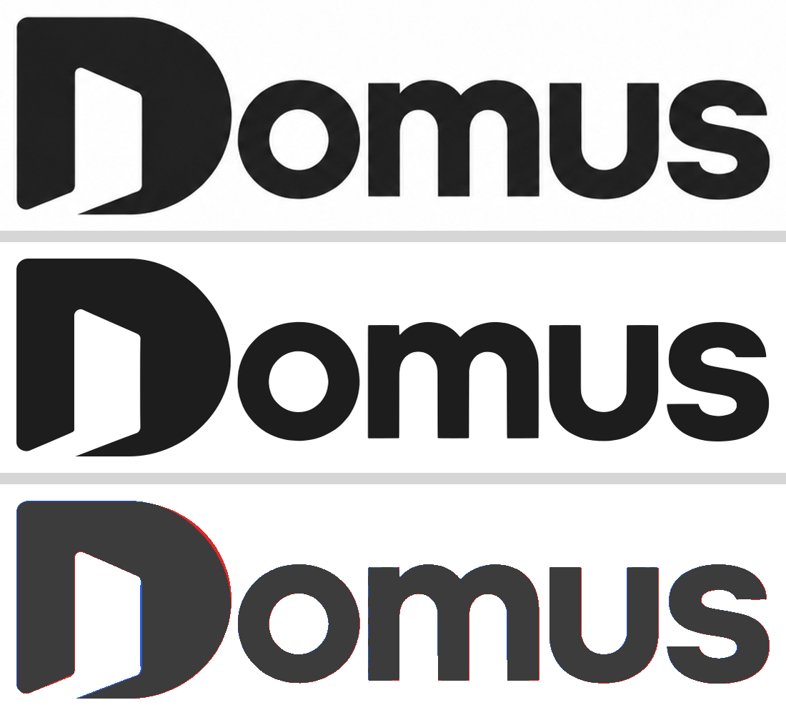

# T9 — M00-F02 brand + M01-F05 MFA (TOTP) + platform area shell + M01-F02 suspended banner

Branch `JI-Serra/h1-t9-ui-foundation`, four commits on top of `52ddf9b` (not pushed):
`M00-F02` brand, `M01-F02` banner, `M01-F05` MFA and platform area, plus a final fixes-and-evidence commit.

## 1. Brand (M00-F02)

| Piece            | Where                                                                                                                                                                                                        |
| ---------------- | ------------------------------------------------------------------------------------------------------------------------------------------------------------------------------------------------------------ |
| Emblem           | Official vector `KnowledgeBase/Brand/Vector/domus-emblem.svg`, used as-is. SVGO only rewrote the path data (3-decimals); the build script renders both and fails if the optimized one drifts (drift = 0).    |
| Wordmark         | Emblem + **"omus" traced** from `Logotipo Merged Domus.png` (potrace on a 6× upscaled, smoothed crop), placed in the emblem's coordinate system from the position/scale of the raster's "D".                 |
| Components       | `<Emblem />`, `<Logo />` (`src/components/brand/`): paint with `currentColor` (light/dark follow the text color), `role="img"` + accessible name "Domus" (or `decorative`).                                  |
| Used in          | Login/auth layout (logo), sidebar header (logo, from 1024 px), mobile top bar (emblem, below 1024 px), `/design` new **Marca** section.                                                                      |
| Standalone files | `public/brand/domus-{emblem,logo}{,-light}.svg`                                                                                                                                                              |
| Icons            | `src/app/icon.svg` (dark-mode aware), `icon.png`, `favicon.ico` (16/32/48), `apple-icon.png`, `public/icons/icon-{192,512}.png` and `icon-maskable-512.png` (emblem inside the central 60 %), `manifest.ts`. |
| Reproducible     | `pnpm --filter @domus/web brand:build` (`scripts/build-brand-assets.mjs`; devDeps `sharp`, `svgo`, `potrace`). Outputs are committed.                                                                        |

**Wordmark comparison** — `docs/screenshots/h1/brand-wordmark-comparison.png`: top = original raster, middle = rebuilt SVG at the same scale,
bottom = difference (grey = both ink, red = only the raster, blue = only the SVG). 2.9 % of the ink pixels differ, all on anti-aliased edges;
the emblem part matches the vector master exactly. Honest limit: "omus" is a trace of a ~1450 px raster, so its straight edges have tiny
kinks (visible at ≥ 100 px height). If a clean vector of the wordmark is ever supplied, drop it into `build-brand-assets.mjs`.



## 2. MFA TOTP (M01-F05)

- **`/account/security`** (route group `(account)`; shell around it, or a bare frame for a user with nothing to act as): enroll (QR + manual key + first
  code), list and remove factors (two-step confirm; removal needs `aal2` — the auth server's `insufficient_aal` is shown as "confirm your identity"
  with a link to the challenge). Abandoned enrollments are discarded on cancel and before the next start. Tenant admins get a **dismissible
  recommendation on this page only** (per-browser `localStorage`, safe when blocked).
- **`/login/mfa`**: challenge for a user with a verified factor. Enforced in `proxy.ts` for every route (an `aal1` session with a factor is always sent
  there, `next` preserved) and directly by the password sign-in action (so the address bar is right). es-AR errors for wrong/malformed code, rate limit, etc.
  Several factors → a selector.
- **Platform admins forced**: any `/platform/**` needs `aal2` — proxy **and** server layout (`app/platform/layout.tsx`, 404 for everybody else, not a
  confirmation that the area exists). No factor → `/account/security?next=/platform…` (with a one-line reason), and after enrolling it continues to `next`;
  factor but `aal1` → `/login/mfa?next=…`. The database independently requires `aal2` (`is_platform_admin()`).
- **Resolver** (`packages/domain/src/context/resolve.ts`): new `platformMfaStep` input/output; below `aal2` the "Plataforma" option is **offered as the pending
  step** (lock icon + "Verificá tu identidad…" / "Activá la verificación…") instead of being hidden. Pure MFA decisions live in `packages/domain/src/auth/mfa.ts`.

## 3. Platform area shell

`/platform` (redirects to `/platform/tenants`), `/platform/tenants` (Barrios), `/platform/support` (Soporte): own navigation (sidebar + tab bar), platform
context forced as active, placeholder pages for the next task. Switching context between platform and tenants navigates to the right area.

## 4. Suspended / cancelled tenants (M01-F02 UI)

- Domain: `tenantAccessMode()`, `isTenantWritable()` (`full` for pilot/active, `read_only` suspended, `blocked` cancelled).
- Status is read from the `tenant` row (`tenant_subscription_status`) through the user's RLS client (`lib/tenant/status.ts`, memoized per request).
- Compact persistent banner "Barrio suspendido · solo lectura" + InfoButton (details), icon + text, stuck under the top bar while scrolling.
- Hooks for later modules: **`useTenantWritable()`** (client, throws if no provider so a write control is never silently enabled) and
  **`getTenantWritable()` / `assertTenantWritable()`** (server; call `assertTenantWritable()` first in every write Server Action — hiding a button is not the control).
- Blocking page for `cancelled`: implemented (`TenantCancelled`, replaces tenant pages inside the shell) **but see finding F1.**

## Findings and decisions to know about

- **F1 — cancelled barrios never reach the blocking page.** `app_private.member_tenant_ids()` already excludes `cancelled` tenants, so for a cancelled tenant the
  user's RLS client cannot read the tenant row and the membership join returns nothing: the user lands on the generic "Todavía no tenés un barrio asignado"
  page. Access is correctly closed at the database, but the message is misleading. If the product wants "El servicio de este barrio está dado de baja", the DB
  needs to expose the status of the user's cancelled memberships (e.g. an RPC returning own memberships incl. cancelled with `tenant_subscription_status`).
  The blocking page stays as defense in depth; the e2e asserts the real behavior.
- **F2 — DB function dependency.** `platform_admin` rows are invisible at `aal1`, so the app cannot know a user is a platform admin before MFA. Used the
  orchestrator-approved `public.current_user_is_platform_admin()` (live in the local DB; called through a typed cast until types are regenerated — see
  `isPlatformAdminAnyLevel` in `lib/context/load.ts`). It only drives navigation; authorization never depends on it.
- **F3 — TOTP must be enabled in the Auth config**: local (`[auth.mfa.totp] enroll_enabled/verify_enabled = true`, done by the DB worker) **and the cloud
  project's dashboard for staging**.
- **F4 — cost.** For users at `aal1` the proxy asks the auth server for the user's factors (`GET /user`, one extra round trip) because the cookie-stored
  session does not carry factors. Platform checks add one RPC for `aal1` users. Fine at this scale; if it ever matters, a custom access-token hook that
  adds a claim removes both.
- **F5 — one UX edge:** a platform admin who enrolls from `/account/security` without a `next` gets the platform shell around the page once the session reaches
  `aal2`, which remounts the page, so the green "activada" notice is replaced by the "Activada" badge and the factor in the list.
- Server Action + proxy redirect: Next does not update the address bar when the proxy answers a Server Action navigation with a redirect, hence the sign-in
  action redirects straight to the challenge (the proxy remains the enforcement).
- New devDependencies (web): `sharp`, `svgo`, `potrace` (brand build), `otpauth`, `pg`, `@types/pg` (e2e only; `pg` is test setup against the local DB, guarded
  to refuse non-local URLs). Exact versions pinned.
- `supabase/**` untouched. Dev/e2e server on port 3001; `apps/web/.env.local` (gitignored) points at the local stack.

## Acceptance output

| Check                                   | Result                                                                                                                                                    |
| --------------------------------------- | --------------------------------------------------------------------------------------------------------------------------------------------------------- |
| `pnpm lint`                             | passed (6 tasks)                                                                                                                                          |
| `pnpm typecheck`                        | passed (6 tasks)                                                                                                                                          |
| `pnpm test`                             | passed: web **259** (22 files), domain **71** (100 % statements / 97 % branches), ui-tokens 26, supabase 15, observability 30                             |
| `pnpm build`                            | passed (Next 16.4.0): new routes `/account/security`, `/login/mfa`, `/platform`, `/platform/tenants`, `/platform/support`, `/manifest.webmanifest`, icons |
| e2e (Playwright, prod build, port 3001) | **120 passed** (desktop-1440 + mobile-360; includes the 12 H1 screenshot tests that write the 24 captures; 0 failed, 0 skipped with `E2E_SCREENSHOTS=1`)  |
| Horizontal overflow at 360 px           | none on login, challenge, security (with recommendation, enrollment open), suspended banner, no-barrio page (asserted in e2e)                             |

New unit/component tests: Logo/Emblem, tenant status hooks + cancelled page, shell (banner, locked platform offer, platform navigation, top bar), MFA challenge
form, enrollment / factor list / recommendation, server actions (challenge, enroll, verify, cancel, remove), layout guards (`/platform`, `(app)`), loaders
(`isPlatformAdminAnyLevel`, `loadPlatformAccess`, tenant status), proxy (challenge redirect, platform guard), error mapping, domain MFA + writability + resolver.

New e2e: `mfa.spec.ts` (enrollment with a code generated by `otpauth`, wrong/malformed code, challenge on the next login, return path, removal, unfinished enrollment,
password-only session stuck at the challenge, recommendation only on the security page, unsafe `next` ignored), `platform.spec.ts` (aal1 → enrollment, enroll →
platform, new session → challenge, tenant user bounced, visitor → login), `tenant-status.spec.ts` (banner, persistence, pilot/active none, cancelled; status set
by SQL on a barrio created for the test), `brand.spec.ts` (logo rendering/theme/shell, `/design` Marca, favicon/apple/manifest/icons served, SVG files).

## Screenshots (`docs/screenshots/h1/`, 360 px and 1440 px, light and dark)

`login-*` (logo) · `shell-*` (sidebar logo at 1440, emblem top bar at 360) · `mfa-enrollment-*` · `mfa-challenge-*` · `suspended-banner-*` · `design-brand-*`
(Marca section) · `brand-wordmark-comparison.png`. Refresh: `E2E_SCREENSHOTS=1 E2E_PORT=3001 pnpm test:e2e screenshots-h1`
(note: that flag also re-runs the H0 screenshot spec, which rewrites `docs/screenshots/h0`).

## How to run

```sh
pnpm --filter @domus/web brand:build        # regenerate brand assets
pnpm build && E2E_PORT=3001 pnpm --filter @domus/web test:e2e   # needs the local Supabase stack with TOTP enabled
```
